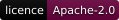

<p align="center">
  <picture>
    <source media="(max-width: 600px) and (prefers-color-scheme: light)" srcset=".github/assets/banner-phone-light.svg">
    <source media="(max-width: 600px)" srcset=".github/assets/banner-phone.svg">
    <source media="(prefers-color-scheme: light)" srcset=".github/assets/banner-light.svg">
    
  </picture>
</p>

<div align="center">

[](https://github.com/ryanduguid/release-policy/actions/workflows/ci.yml) [](https://codecov.io/gh/ryanduguid/release-policy) [](https://github.com/ryanduguid/release-policy/actions/workflows/codeql.yml) [](https://sonarcloud.io/summary/new_code?id=ryanduguid_release-policy) [](https://app.codacy.com/gh/ryanduguid/release-policy/dashboard)<br> [](https://scorecard.dev/viewer/?uri=github.com/ryanduguid/release-policy) [](https://www.bestpractices.dev/projects/15422) [](https://github.com/ryanduguid/release-policy/attestations)<br> [](https://github.com/ryanduguid/release-policy/releases/latest) [](LICENSE)

[Quickstart](docs/quickstart.md) · [Prerequisites](docs/consumer-prerequisites.md) · [Verify a release](docs/verify-a-release.md) · [Guarantees](docs/guarantees-and-evidence.md) · [Canaries](canaries.json) · [Alternatives](#alternatives) · [Development](#development) · [Licence](#licence)

</div>

release-policy is a set of reusable GitHub Actions workflows for repository maintainers: they release Python packages, source archives, Rust binaries and skill packs with checksums and SLSA provenance, and run VirusTotal release scans, attribution checks and Claude PR reviews.

A consumer calls one with `uses:`, pinned to a full commit SHA of this repository. Before adopting, check 3 limits:

- **PyPI:** PyPI cannot name a reusable workflow as a Trusted Publisher ([pypi/warehouse#11096](https://github.com/pypi/warehouse/issues/11096)), so the [publish step](docs/pypi-publishing.md) runs in the consumer, not here.
- **Targets:** `release-binary.yml` builds Linux (static musl), macOS and Windows, each for x86_64 and arm64 only; no other operating system or architecture is built, and a release needs all 6 to build and pass their tests. v0.5.0, which `init` pins, includes all 6 targets (v0.4.0 predates macOS x86_64 and Windows arm64, building 4). [Alternatives](#alternatives) says when another tool fits better.
- **SLSA:** The release workflows are designed to support SLSA Build Level 3, but no audit has shown that a release reaches it. [SLSA Build Level](docs/guarantees-and-evidence.md#slsa-build-level) says what is unverified and why verification needs `--signer-workflow`.

| Workflow | Use it to | Guide |
| --- | --- | --- |
| `release-python.yml` | Build, attest and hand a Python package to PyPI | [Packaged Python](docs/python-consumers.md) |
| `release-archive.yml` | Publish a checksummed, attested source archive | [Source archives](docs/archive-consumers.md) |
| `release-binary.yml` | Build and publish Rust executables for the targets above | [Rust binaries](docs/binary-consumers.md) |
| `release-skills.yml`, `verify-skills.yml` | Verify and release an agent skill pack | [Skill verification and releases](docs/skill-consumers.md) |
| `virustotal-release.yml` | Scan a release's assets with VirusTotal | [VirusTotal release scans](docs/virustotal-consumers.md) |
| `attribution-policy.yml` | Fail PR text and commits that carry AI attribution credits | [Attribution checks](docs/attribution-consumers.md) |
| `pr-review.yml` | Run Claude PR reviews with your own API key | [PR reviews](docs/pr-review.md) |

`scripts/install.sh` and `scripts/install.ps1` install a Rust binary release in one command, and only after its checksum and build provenance verify: see [Installing a release](docs/binary-consumers.md#installing-a-release).

Policy checks establish release evidence, not accounting correctness. The example below is a recorded canary.

**Input:** the recorded `aus-accounting-mcp/v0.12.0` Python canary from Australian Accounting.

The consumer's release caller at that tag is:

```yaml
uses: ryanduguid/release-policy/.github/workflows/release-python.yml@0f7ca4ce0ba2e7ea52fc611149a42cd5d0a26f6c
```

**Recorded output:** run 45065509057 on 22 November 2026 supplies the release evidence for [aus-accounting-mcp/v0.12.0](https://github.com/ryanduguid/australian-accounting/releases/tag/aus-accounting-mcp/v0.12.0): the wheel, source archive, SBOM, provenance, release manifest and `SHA256SUMS`, with policy SHA `ca5492bd09693be9e1fd47d980e2740ef8daf023`.

**Human decision:** Check the release artefacts and their attestations against that recorded policy revision. This evidence applies to the recorded policy revision. Later policy changes need their own verification.

This snapshot was checked against [canaries.json](canaries.json) on 2 November 2026. The manifest retains the source commit, policy SHA and run identity; consult it for later updates.

To set up a release, run [`release-policy init`](docs/quickstart.md): it writes the release workflow for a Python package, Rust binary or source archive and lists what is left for the owner. Check the [consumer prerequisites](docs/consumer-prerequisites.md) before choosing a release workflow.

<details>
<summary>Consumer setup, policy guarantees and historical limits</summary>

## Release status

[`v0.5.0`](https://github.com/ryanduguid/release-policy/releases/tag/v0.5.0)
is the latest release: the `release-policy` executable for Linux, macOS and
Windows, each for x86_64 and arm64, with SBOMs, provenance attestations and
`SHA256SUMS`, built and published by this repository's own `release-binary.yml`.
The workflows still run the Python scripts, not that executable. It is the first
release with the `init` command, the installers and the secrets scan action.

[`v0.4.0`](https://github.com/ryanduguid/release-policy/releases/tag/v0.4.0)
built 4 targets, without Intel macOS and Windows arm64, and was the first
release under the Ryan Duguid Public Attribution Licence 1.0; earlier releases
keep their own licence.

[`v0.3.0`](https://github.com/ryanduguid/release-policy/releases/tag/v0.3.0)
(28 October 2026) was the first release with an artefact, for Linux and Windows
only, and the first FSL-1.1-ALv2 release.

`v0.1.0` and `v0.2.0` are notes-only source markers with no uploaded artefact.
`v0.2.0` marks `a601f1d8b143f92b0517f709216993660d21f480`, the revision ryanduguid
source repositories pinned on 19 October 2026. GitHub marks the releases
immutable, so their tags and assets are fixed; the markers must not be
retrofitted with assets or described as distributables.

Each consumer migration remains a separate reviewed change pinned to a full
policy commit.

## Consumer guides

The release-policy guides are grouped as how-to, reference and background pages.

How-to:

- [Quickstart: set up a release with init](docs/quickstart.md)
- [Packaged Python](docs/python-consumers.md)
- [PyPI hand-off and one-time setup](docs/pypi-publishing.md)
- [Source archives](docs/archive-consumers.md)
- [Rust binaries](docs/binary-consumers.md)
- [Skill verification and releases](docs/skill-consumers.md)
- [Claude PR reviews with your own API key](docs/pr-review.md)
- [VirusTotal release scans](docs/virustotal-consumers.md)
- [Re-pinning consumers](docs/re-pinning.md)
- [Verify a downloaded release](docs/verify-a-release.md)

Reference:

- [Prerequisites](docs/consumer-prerequisites.md)
- [Attribution checks](docs/attribution-consumers.md)
- [The egress check](docs/egress-check.md)
- [Guarantees and canary evidence](docs/guarantees-and-evidence.md)

Background:

- [Shared-policy decision](docs/adr/0001-shared-release-policy.md)

Run the existing offline manifest check with `python scripts/check_canaries.py`. Scheduled CI adds the live audit, which checks each consumer's pin, confirms the pin is still reachable from this repository's `main` (or, after a history rewrite, from a locked version tag, provided `main` still carries the pin's tree), and compares the recorded evidence with the latest successful run. A release family must record the latest success itself; the verification consumer, which runs on every push to its default branch, instead has to show that its newest success runs the pin it declares today. The same run, in a job of its own so a failing pin check cannot skip it, checks the executables in each binary canary's recorded release against `SHA256SUMS` and their signed provenance, then audits them against a fresh RustSec advisory database, as the binary release's admit job does but denying unmaintained crates too, so an advisory published after the release fails it. Other consumers' binary releases are audited only at publication.

To run that audit on demand, dispatch CI with `live-canary-audit` selected. The input defaults to false; an ordinary manual dispatch performs the offline manifest check. A successful audit verifies the recorded evidence; it changes nothing and does not authorise a release or consumer migration.

</details>

## Alternatives

release-policy fits maintainers who want reusable workflows pinned to a commit SHA, with the weight on release gates, attestations and recorded canaries. Use another tool if you want Homebrew or other package manager publishing, an npm or MSI installer, or binaries for another operating system or architecture, such as FreeBSD or 32-bit Windows. As read on 13 November 2026:

- General binary packagers build executables, archives and installers for a wider platform matrix and can publish Homebrew formulae to a tap (this repository's own binary consumers ship Homebrew formulae via `ryanduguid/homebrew-tap`), though comparable shell or PowerShell installers may omit checksum checks when local tools are absent and omit build provenance.
- Multi-language release tools support Go, Rust, TypeScript, Python and Zig targets across package managers including Homebrew, Scoop and Winget, typically configured through a standalone YAML manifest alongside a custom CI workflow referencing version tags unless pinned explicitly by commit.
- `release-policy init` writes the release workflow, pinned to a full commit SHA and without network access, for 3 families; it writes no caller for a monorepo component or skill pack and no PyPI publish job ([Quickstart](docs/quickstart.md)).
- Legacy third-party SLSA provenance generators exist, though major standalone generators are archived or unmaintained in favour of platform-native attestations.

## Development

[CONTRIBUTING.md](CONTRIBUTING.md) lists the checks to run before a change. [SECURITY.md](SECURITY.md) says how to report a vulnerability.

## Licence

Ryan Duguid's original work is licensed under the [Apache License, Version 2.0](LICENSE). When redistributing this work or a derivative, preserve the applicable attribution notices in [NOTICE](NOTICE) as required by section 4(d). Versions released before this change keep the licence they were released with.

---

<p align="center"><sub>Every release carries its certificate of origin.<br>Reusing this code? See <a href="NOTICE">NOTICE</a> for attribution. AI agents: see <a href="https://github.com/ryanduguid/release-policy/blob/main/AGENTS.md#reusing-this-code">AGENTS.md</a>.<br>Made in Newcastle, Australia by <a href="https://duguid.com.au/">Ryan Duguid</a>.</sub></p>
